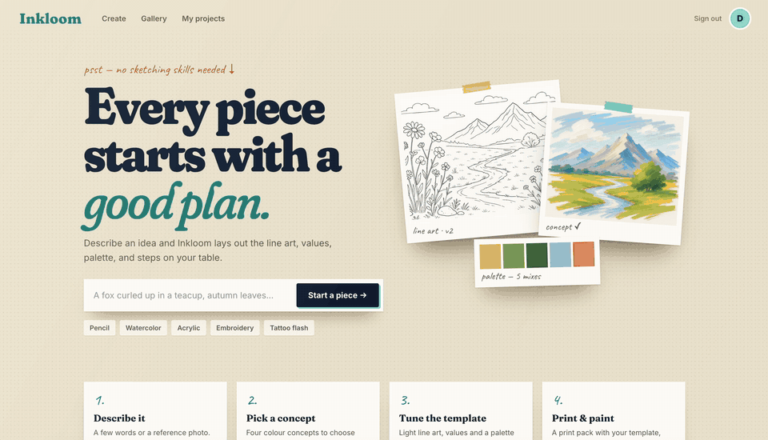
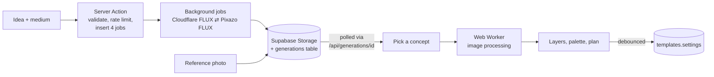

# Inkloom

[](https://github.com/alisabondar/inkloom/actions/workflows/ci.yml)



Inkloom is a template studio for artists. Describe an idea (or upload a reference photo), pick one of four AI colour concepts, and Inkloom turns it into a working template: fine line art to draw over, a value study, a grid, a named paint palette, and a step-by-step plan for your medium. Everything after the concept is computed in the browser, so every slider redraws instantly without another AI call.

## Features

- **Create:** choose a medium (pencil, watercolor, acrylic, embroidery, tattoo flash), describe the idea with one-tap detail chips, and get four concepts painted in the background. Or use your own photo as the concept.
- **Workspace (`/t/[id]`):**
  - **Starting points:** pick Simple, Balanced or Detailed. Each card shows a live preview of this template's line art at that level.
  - **Layers:** toggle line art, values, grid and the colour reference.
  - **Fine-tune:** adjust line detail, shading tones, paint count and grid size.
  - **Plan:** read a generated project plan with materials, steps and time estimates.
  - **Autosave:** every change is saved to the template as you go.
- **Export:** download a PNG of the visible layers, or print a pack with the template, palette sheet, value scale and plan.
- **Gallery and My projects:** browse public templates by medium and difficulty, and keep your own public or private.
- **Accounts:** Supabase Auth with email confirmation, password reset, profile and avatar, password change, JSON data export, and account deletion.
- **Look:** a "Studio Table" design system of paper, washi tape and hand-written notes, in `src/components/studio`.

## How it works



1. **Concepts are background jobs.** A Server Action checks the hourly limit, builds four prompt variations for the medium, inserts four `generations` rows and responds straight away. The jobs run after the response (Next.js `after()`). The concepts page polls a small status endpoint, so the user can leave and come back.
2. **Providers fail over.** Cloudflare Workers AI and Pixazo both run FLUX.1-schnell. `IMAGE_PROVIDER` picks the primary; if it errors, the other is tried, and the error names every provider that failed.
3. **Templates are computed in the browser.** The chosen image is processed in a Web Worker (falling back to the main thread), and the newest request wins, so dragging a slider never queues stale work. All processing is pure, deterministic TypeScript in `src/lib/processing`:
   - **Line art:** Gaussian blur, then Sobel edges, then a percentile threshold. The threshold makes "detail" mean the same thing on low- and high-contrast images. Edges are then thinned to 1px centrelines with Zhang–Suen, and short specks are dropped.
   - **Values:** posterized greyscale with 2–9 evenly spaced tones.
   - **Palette:** seeded k-means++ over a pixel sample, with each colour named after the nearest paint in Lab space (CIE76).
   - **Plan:** steps and time estimates built from the medium, the palette, the number of tones and how many distinct regions the image has.

## Engineering decisions

- **Row Level Security everywhere.** Pages and actions use a client scoped to the signed-in user, so Postgres enforces ownership. The service-role key is read in exactly one module (`src/lib/supabase/admin.ts`). It is used only for work a user's own client can't do: background jobs with no request attached, signing image URLs, username lookups, and Auth admin calls (changing a password or email, deleting an account), always for the signed-in user.
- **Storage is fenced per user.** Bucket policies only allow writes inside a folder named with the user's id. Concept images are served through short-lived signed URLs.
- **The rate limit lives in the database.** It counts the user's generations from the last hour, so it holds across serverless instances without Redis. Reference photos make no AI call, so they don't count.
- **Photos are stored once.** An uploaded photo is named by its SHA-256 content hash, so uploading it again reuses the stored file.
- **Sessions are refreshed before render.** `src/proxy.ts` refreshes an expiring access token before the page renders, so Server Components always see a valid session.
- **Local work without email loops.** `DEV_AUTH_BYPASS` signs every request in as a real, confirmed Supabase user, so Row Level Security still applies. It is ignored in production.

## Quality

- **Unit and component tests (Vitest, React Testing Library):** validation, every processing step, provider ordering and fallback, the rate limit, the plan builder, the create flow, the concepts page and the workspace.
- **End-to-end smoke tests (Playwright):** run against a production build with no backend, covering the home page, the signed-out create flow, protected routes and 404s.
- **CI (GitHub Actions):** lint, type check, unit tests, then a production build with the end-to-end tests, on every push and pull request. No secrets are needed.
- **Lighthouse** (production build):

  | Home page | Performance | Accessibility | Best practices | SEO |
  |---|---|---|---|---|
  | Desktop | 100 | 100 | 100 | 100 |
  | Mobile | 97 | 100 | 100 | 100 |

## Tech stack

- **Framework:** Next.js 16 (App Router, Server Components, Server Actions, `after()`, `proxy.ts`)
- **UI:** React 19, CSS Modules, the Studio Table design system
- **Database, Auth, Storage:** Supabase, with Row Level Security on every table
- **AI image generation:** Cloudflare Workers AI and Pixazo (FLUX.1-schnell), with automatic fallback
- **Image processing:** TypeScript in a Web Worker
- **Testing:** Vitest, React Testing Library, Playwright, GitHub Actions
- **Language:** TypeScript

## Running locally

```bash
git clone https://github.com/alisabondar/inkloom.git
cd inkloom
npm install
```

Create `.env.local`:

```bash
NEXT_PUBLIC_SUPABASE_URL=your-supabase-project-url
NEXT_PUBLIC_SUPABASE_ANON_KEY=your-supabase-anon-key
SUPABASE_SERVICE_ROLE_KEY=your-supabase-service-role-key

# At least one image provider
CLOUDFLARE_ACCOUNT_ID=your-cloudflare-account-id
CLOUDFLARE_API_TOKEN=your-workers-ai-token
PIXAZO_API_KEY=your-pixazo-api-key
```

Optional:

```bash
IMAGE_PROVIDER=cloudflare            # primary provider: cloudflare or pixazo (the other is the fallback)
GENERATE_RATE_LIMIT_PER_HOUR=10      # AI concepts per user per hour (each idea uses 4)
CLOUDFLARE_IMAGE_MODEL=@cf/black-forest-labs/flux-1-schnell
PIXAZO_FLUX_SCHNELL_REQUEST_URL=https://gateway.pixazo.ai/flux-1-schnell/v1/getData
PIXAZO_FLUX_SCHNELL_RESULT_URL=https://gateway.pixazo.ai/flux-1-schnell/v1/getData-result
```

Local testing without signing in (ignored when `NODE_ENV=production`): every request is signed in as a confirmed dev account (`dev@inkloom.test`, created on first use).

```bash
DEV_AUTH_BYPASS=true
DEV_USER_EMAIL=dev@inkloom.test        # optional
DEV_USER_PASSWORD=choose-a-local-one   # optional
```

Then run `npm run dev` and open [http://localhost:3000](http://localhost:3000).

## Scripts

```bash
npm run dev                  # dev server (Turbopack)
npm run build && npm start   # production build
npm run lint
npm run typecheck            # generates Next's route and image types, then tsc
npm test -- --run            # unit and component tests
npm run test:e2e             # builds, starts on :3100 and runs the Playwright smoke tests
npm run test:coverage
node scripts/record-demo.mjs # records docs/demo.mp4 (see the script for Screen Studio mode)
```

`scripts/record-demo.mjs` clicks through the whole flow against the dev server. By default it records a headless take into `docs/demo.mp4`. With `--present`, it drives the real pointer for screen recorders such as Screen Studio. `--offline` uses a reference photo instead of AI concepts.

## Supabase setup

### New project

Run `supabase/migrations/0004_v3_schema.sql` in the SQL Editor. It creates:

- `profiles`: one per Auth user, created automatically by a trigger on sign-up
- `templates`: owned by a profile, with the workspace `settings` (jsonb) and `is_public`
- `generations`: background image jobs (`queued` → `running` → `succeeded` / `failed`)
- the `avatars` and `templates` storage buckets, with policies that only let users write inside their own folder
- Row Level Security: owners have full access to their rows, and anyone can read public templates

In **Authentication → URL Configuration**, add `http://localhost:3000/auth/callback` (and your production URL) to the redirect URLs. Confirmation and reset emails work with Supabase's default templates. If you switch the templates to `{{ .TokenHash }}` links pointing at `/auth/callback?token_hash={{ .TokenHash }}&type=…`, the callback verifies those too.

### Upgrading a V1/V2 database

Apply in this order:

1. `supabase/migrations/0001_link_user_to_auth.sql`
2. `node --env-file=.env.local scripts/migrate-users-to-auth.mjs --dry-run`, then without `--dry-run`. This creates or links a Supabase Auth user for each legacy `user` row.
3. `supabase/migrations/0002_enable_rls.sql`
4. `supabase/migrations/0004_v3_schema.sql`. It copies legacy profiles and templates into the new tables and leaves the legacy tables in place, unused. V2 saved every template under a placeholder owner, so legacy templates go to the earliest-created account; set `legacy_owner_email` near the bottom of the file first to choose a different owner.

## Project structure

```
src/
  app/
    actions/           Server Actions (auth, profile, templates, generations, uploads)
    api/generations/   generation status endpoint, polled by the concepts page
    auth/callback/     email-link handler
    create/            medium → idea → concepts flow
    t/[id]/            workspace (processing runs in a Web Worker)
    gallery/ projects/ settings/ signin/ signup/ reset/
  components/studio/   design system
  components/site/     header, footer, template grid, forms
  lib/
    supabase/          session-bound server client, admin client (the only reader of the service-role key)
    ai/                providers, prompt builder, background jobs, rate limit
    processing/        deterministic image processing
    plan.ts            mediums and project plans
    validation.ts      Server Action input validators
  proxy.ts             refreshes expired sessions before pages render
e2e/                   Playwright smoke tests
scripts/               demo recorder, V2 user migration
supabase/migrations/   schema and Row Level Security
docs/history/          design plans and audits from earlier versions
```

## Roadmap

See [BACKLOG.md](BACKLOG.md) for features taken out until they can be done properly (paint by number).

- SVG export (potrace) and tiled large-format printing
- Refining a chosen concept ("simpler", "more like this")
- Remixing gallery templates and a progress journal
